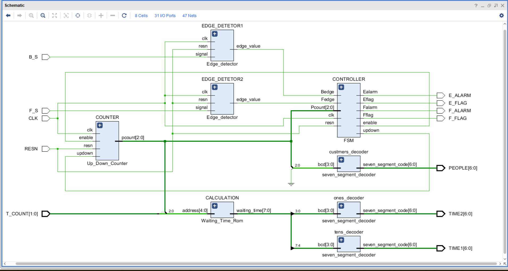
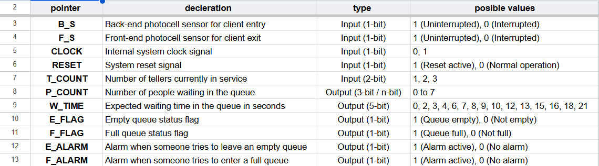
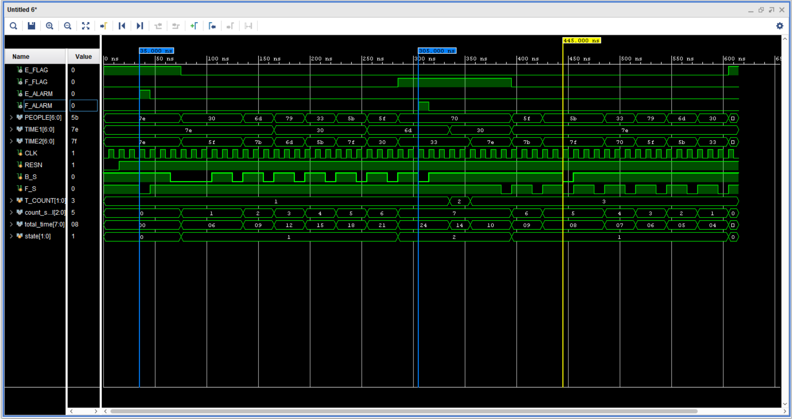
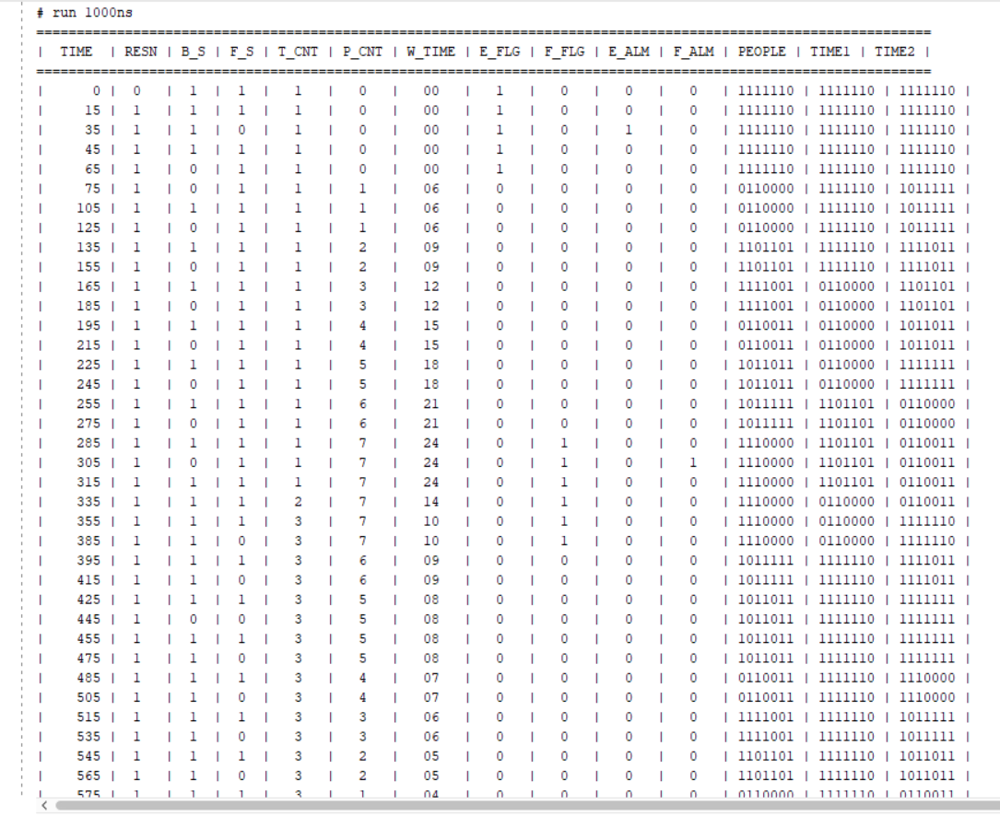

# ITI_BQS — Bank Queue Monitoring System (Verilog RTL & Verification)

An RTL design and functional verification project for an embedded **Bank Queue Monitoring System (`ITI_BQS`)** implemented in **Verilog** and verified using **Xilinx Vivado**[cite: 12]. The system monitors real-time client flow, tracks queue occupancy, estimates waiting times dynamically based on active tellers, and drives Seven-Segment Displays alongside status flags and boundary alarms[cite: 12, 13].

---

## System Architecture & Modules

The design follows a modular, hierarchical mixed-architecture approach emphasizing **Design Reuse** and **Parameterized RTL**[cite: 12, 13]:

* **`ITI_BQS.v` (Top Module):** Integrates all sub-modules using structural instantiations and named port mapping[cite: 18].
* **`Edge_detector.v` & `Flip_Flop.v`:** Reusable falling-edge detection circuit that converts prolonged active-low photocell interruptions (`1 -> 0`) into a clean single-cycle pulse (`~signal & delay_input`), preventing multiple counts per client[cite: 13, 15, 16].
* **`FSM.v` (3-Always-Block Mealy Controller):** Manages `EMPTY`, `COUNT`, and `FULL` states while separating state registers, next-state logic, and output logic[cite: 17]. Prevents counter wrap-around (overflow/underflow) and generates concurrent flags and alarms[cite: 13, 17].
* **`Up_Down_Counter.v`:** Parameterized `n`-bit behavioral counter (`counterwidth = 3`, max capacity = $2^n - 1 = 7$) with asynchronous active-low reset (`RESN`), `enable`, and `updown` control[cite: 12, 22].
* **`Waiting_Time_Rom.v` & `rom_initialization_file.mem`:** A $32 \times 8$-bit ROM Look-Up Table (LUT) indexed via concatenation `{T_COUNT, P_COUNT}`[cite: 18, 23]. Replaces costly hardware division with constant-time lookup for $\text{Wtime} = \lfloor 3 \times (\text{Pcount} + \text{Tcount} - 1) / \text{Tcount} \rfloor$ stored in BCD format[cite: 12].
* **`Seven_Segment_Decoder.v`:** Combinational BCD-to-7-segment decoder instantiated three times to drive `PEOPLE`, `TIME1` (tens), and `TIME2` (ones)[cite: 18, 20].

---

## Port Interface (`ITI_BQS`)

| Signal | Direction | Width | Description |
| :--- | :---: | :---: | :--- |
| `CLK` | Input | 1-bit | Internal system clock[cite: 12, 18] |
| `RESN` | Input | 1-bit | Asynchronous active-low reset (`0` clears count & `F_FLAG`, sets `E_FLAG`)[cite: 12, 18] |
| `B_S` | Input | 1-bit | Back-end photocell sensor (active-low: `1` = idle, `0` = client entering)[cite: 12, 18] |
| `F_S` | Input | 1-bit | Front-end photocell sensor (active-low: `1` = idle, `0` = client leaving)[cite: 12, 18] |
| `T_COUNT` | Input | 2-bit | Number of active tellers in service (`1`, `2`, or `3`)[cite: 12, 18] |
| `E_FLAG` | Output | 1-bit | High (`1`) when the queue is empty (`Pcount == 0`)[cite: 12, 17, 18] |
| `F_FLAG` | Output | 1-bit | High (`1`) when the queue is full (`Pcount == 7`)[cite: 12, 17, 18] |
| `E_ALARM` | Output | 1-bit | Pulses high (`1`) if a client tries to leave while the queue is empty[cite: 13, 17, 18] |
| `F_ALARM` | Output | 1-bit | Pulses high (`1`) if a client tries to enter while the queue is full[cite: 13, 17, 18] |
| `PEOPLE` | Output | 7-bit | 7-segment code displaying current queue count (`Pcount`)[cite: 12, 18] |
| `TIME1` | Output | 7-bit | 7-segment code displaying tens digit of expected waiting time (`Wtime`)[cite: 12, 18] |
| `TIME2` | Output | 7-bit | 7-segment code displaying ones digit of expected waiting time (`Wtime`)[cite: 12, 18] |

---

## RTL Schematic & Design Diagrams

### Elaborated RTL Schematic (Xilinx Vivado)

### System Overview & Signal Declaration

---

## Functional Verification (`ITI_BQS_TB.v`)

A self-checking testbench was developed using reusable tasks (`enter_client`, `leave_client`) synchronized to `posedge CLK` with non-blocking assignments (`<=`) to avoid race conditions[cite: 19].

### Verified Scenarios
1. **Asynchronous Active-Low Reset:** Verifies `Pcount = 0`, `Wtime = 00`, `E_FLAG = 1`, and `F_FLAG = 0`[cite: 10, 12, 19].
2. **Empty Queue Alarm (`E_ALARM`):** Triggers exit event at `Pcount = 0`; confirms `E_ALARM` asserts without counter underflow (`0 -> 7` prevented)[cite: 10, 13, 19].
3. **Long Sensor Interruption Filtering:** Holds `B_S = 0` for 4 consecutive clock cycles; verifies `Pcount` increments by `1` only[cite: 10, 12, 19].
4. **Queue Fill & Full Flag (`F_FLAG`):** Increments `Pcount` up to maximum capacity (`7`) and asserts `F_FLAG`[cite: 10, 12, 19].
5. **Full Queue Alarm (`F_ALARM`):** Triggers entry event at `Pcount = 7`; confirms `F_ALARM` asserts without counter overflow (`7 -> 0` prevented)[cite: 10, 13, 19].
6. **Dynamic ROM Waiting Time Lookup:** Varies `T_COUNT` (`1 -> 2 -> 3`) at full capacity and verifies real-time waiting time updates (`24s -> 14s -> 10s`)[cite: 10, 19].
7. **Simultaneous Entry & Exit:** Asserts `B_S = 0` and `F_S = 0` in the same cycle; confirms net count remains unchanged[cite: 10, 19].
8. **Complete Queue Drain:** Decrements queue back to `0` and verifies `E_FLAG` re-assertion[cite: 10, 19].

### Simulation Waveform

### Simulation Transcript Log

---

## Tools & Technologies
* **HDL:** Verilog (IEEE 1364-2001)
* **EDA Tool:** Xilinx Vivado (RTL Elaboration, Synthesis & XSim Behavioral Simulation)
* **Reference:** Inspired by the Digital IC Design curriculum (ITI / Mahara-Tech — Dr. Ahmed Shalaby)[cite: 13].
